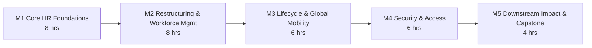

# Oracle HRO Enterprise Enablement Program

**Genpact · Virtual Instructor-Led Training (VILT) · Oracle Fusion Cloud HCM · Intermediate**

27 October – 8 December 2026 · Tuesdays & Thursdays · 6:30 PM IST onward
Lead Trainer: **Udayakumar M** – Global Enterprise Technology & AI Transformation Advisor | Corporate Trainer

| 32 | 12 | 5 | 1 |
|:--:|:--:|:--:|:--:|
| **Hours** | **Live sessions** | **Modules + labs** | **End-to-end capstone** |

---

## Table of contents

1. [About the program](#1-about-the-program)
2. [Modules in scope](#2-modules-in-scope)
3. [Session schedule](#3-session-schedule)
4. [Daily session rhythm](#4-daily-session-rhythm)
5. [How to use this repository](#5-how-to-use-this-repository)
6. [Lab environment](#6-lab-environment)
7. [Pre-training checklist](#7-pre-training-checklist)
8. [Communication, LMS and attendance](#8-communication-lms-and-attendance)
9. [Assessment and certification](#9-assessment-and-certification)
10. [Feedback](#10-feedback)
11. [Support and contacts](#11-support-and-contacts)

---

## 1. About the program

This 32-hour instructor-led program builds the capability to configure, restructure, secure and support **Oracle Fusion Cloud HCM** for multi-entity, multi-country workforces, through a concept-plus-demonstration-plus-hands-on-lab approach.

The journey runs through five connected modules:

1. **Core HR foundations**: enterprise structures, legal entities, workforce structures, people management and employment processes.
2. **Organizational restructuring and workforce management**: legal entity consolidation, department hierarchies, position management, mass updates.
3. **Employee lifecycle and global mobility**.
4. **Security and access management**: role-based access, data roles, country and legal-employer security, troubleshooting.
5. **Downstream impact assessment**: Payroll, Benefits, Time & Labor, integrations and reporting, finishing with an end-to-end capstone case study.



### Delivery framework

| | |
|---|---|
| **Per session** | 2.5 hours (Sessions 1–8) · 3 hours (Sessions 9–12) |
| **Timing** | Starts 6:30 PM IST · ends 9:00 PM IST (Sessions 1–8) / 9:30 PM IST (Sessions 9–12) |
| **Cadence** | Tuesdays and Thursdays, weekends excluded · **no session on Thursday 29 Oct 2026** |
| **Mode** | Live virtual instruction on Microsoft Teams with hands-on labs |
| **Platform** | Oracle Fusion Cloud HCM lab environment, prepared and ready for the program |
| **Duration** | **32 hours** (12 sessions: 8 × 2.5 h + 4 × 3 h) · 27 Oct – 8 Dec 2026 |

---

## 2. Modules in scope

| Module | Duration | Sessions | Outcome |
|---|:--:|:--:|---|
| **1 · Oracle Core HR Foundations** | 8 hrs | S1 – S4 | Hire, transfer and terminate a worker independently |
| **2 · Organizational Restructuring & Workforce Management** | 8 hrs | S4 – S7 | Deliver multi-country restructuring within SLA |
| **3 · Employee Lifecycle & Global Mobility** | 6 hrs | S7 – S9 | Support global assignments and lifecycle changes first time |
| **4 · Oracle Security & Access Management** | 6 hrs | S9 – S11 | Enforce country / legal-employer data segregation |
| **5 · Downstream Impact Assessment & Case Studies** | 4 hrs | S11 – S12 | Protect Payroll, Benefits and reporting integrity end to end |
| **Total** | **32 hrs** | **12 sessions** | |

---

## 3. Session schedule

All times are IST. Sessions 1–8 run 6:30 – 9:00 PM; Sessions 9–12 run 6:30 – 9:30 PM.

| Session | Date | Time (IST) | Hrs | Focus |
|:--:|---|---|:--:|---|
| **S1** | Tue, 27 Oct 2026 | 6:30 – 9:00 PM | 2.5 | **M1** · Kick-off & orientation · HCM Overview, Enterprise Structures, Legal Entities. **Lab:** build Enterprise, Business Unit and Legal Employer |
| **S2** | Tue, 03 Nov 2026 | 6:30 – 9:00 PM | 2.5 | **M1** · Workforce Structures: Divisions, Departments, Jobs, Grades, Positions. **Lab:** build the full hierarchy |
| **S3** | Thu, 05 Nov 2026 | 6:30 – 9:00 PM | 2.5 | **M1** · People Management & Employment Processes. **Lab:** hire, promote, transfer, terminate |
| **S4** | Tue, 10 Nov 2026 | 6:30 – 9:00 PM | 2.5 | **M1** Q&A and knowledge check (0.5 h) · **M2** Legal Entity Consolidation (2 h). **Lab:** merge two Legal Employers |
| **S5** | Thu, 12 Nov 2026 | 6:30 – 9:00 PM | 2.5 | **M2** · Global Organizational Restructuring & Department Hierarchies. **Lab:** cross-country realignment, re-parenting |
| **S6** | Tue, 17 Nov 2026 | 6:30 – 9:00 PM | 2.5 | **M2** · Position Management & Workforce Movement. **Lab:** position hierarchy, bulk transfers |
| **S7** | Thu, 19 Nov 2026 | 6:30 – 9:00 PM | 2.5 | **M2** Mass Employee Updates + Q&A (1 h). **Lab:** HDL batch update, 500-worker cohort · **M3** Employee Transfers & Employment Changes (1.5 h). **Lab:** Global Transfer vs Add Assignment · Mid assessment released |
| **S8** | Tue, 24 Nov 2026 | 6:30 – 9:00 PM | 2.5 | **M3** · International Assignments & Manager Changes. **Lab:** Home/Host global assignment, approval-chain trace |
| **S9** | Thu, 26 Nov 2026 | 6:30 – 9:30 PM | 3 | **M3** Organizational Impact Assessment, Reporting Impact + Q&A (2 h). **Lab:** pre/post OTBI comparison · **M4** Security Concepts (1 h). **Lab:** Security Console walkthrough |
| **S10** | Tue, 01 Dec 2026 | 6:30 – 9:30 PM | 3 | **M4** · Role-Based Access, HR Specialist vs HR Manager, Country / Legal Employer Security. **Lab:** custom role + country-scoped Data Role |
| **S11** | Thu, 03 Dec 2026 | 6:30 – 9:30 PM | 3 | **M4** Data Roles, Security Troubleshooting + Q&A (2 h). **Lab:** diagnose access-denied incidents · **M5** Payroll & Benefits impact (1 h). **Lab:** mid-cycle transfer trace |
| **S12** | Tue, 08 Dec 2026 | 6:30 – 9:30 PM | 3 | **M5** · Time & Labor, Integrations, Reporting, Data Warehouse, Third-Party Apps · End-to-end capstone case study · Final Q&A, final assessment, closure |

**Phases:** Foundations (S1–4) · Restructure & Mobility (S5–8) · Secure, Assess & Capstone (S9–12).

### Calendar at a glance

```text
OCTOBER 2026                     NOVEMBER 2026                    DECEMBER 2026
Tue 27  S1 (2.5h)                Tue  3  S2 (2.5h)                Tue  1  S10 (3h)
Thu 29  no session               Thu  5  S3 (2.5h)                Thu  3  S11 (3h)
                                 Tue 10  S4 (2.5h)                Tue  8  S12 (3h)  <- last session
                                 Thu 12  S5 (2.5h)
                                 Tue 17  S6 (2.5h)
                                 Thu 19  S7 (2.5h)
                                 Tue 24  S8 (2.5h)
                                 Thu 26  S9 (3h)
```

---

## 4. Daily session rhythm

Every session follows the same **Explain – Demonstrate – Practise – Validate** rhythm. Sessions 9–12 run 30 minutes longer, with the extra time going mostly to demonstration and hands-on lab blocks.

**Sessions 1–8 · 2.5 hours (6:30 – 9:00 PM IST)**

| Time (IST) | Block | What happens |
|---|---|---|
| 6:30 – 7:10 | **Concept & Explain** (40 min) | Concepts, Oracle design and the "why" behind each setup |
| 7:10 – 7:55 | **Demonstration & Guided Lab** (45 min) | Trainer demonstrates in the HCM environment, then you follow along |
| 7:55 – 8:05 | **Break** (10 min) | Stretch break |
| 8:05 – 8:40 | **Hands-on Lab & Scenario Challenge** (35 min) | Independent lab; trainer supports each participant |
| 8:40 – 9:00 | **Q&A, Review & Knowledge Check** (20 min) | Answer walkthrough, short quiz and next-session preview |

**Sessions 9–12 · 3 hours (6:30 – 9:30 PM IST)**

| Time (IST) | Block | What happens |
|---|---|---|
| 6:30 – 7:15 | **Concept & Explain** (45 min) | Concepts, Oracle design and the "why" behind each setup |
| 7:15 – 8:10 | **Demonstration & Guided Lab** (55 min) | Trainer demonstrates in the HCM environment, then you follow along |
| 8:10 – 8:20 | **Break** (10 min) | Stretch break |
| 8:20 – 9:10 | **Hands-on Lab & Scenario Challenge** (50 min) | Security, impact-assessment and capstone work |
| 9:10 – 9:30 | **Q&A, Review & Knowledge Check** (20 min) | Answer walkthrough, short quiz and next-session preview |

---

## 5. How to use this repository

This repository is the central home for lab guides, sample data sets, workbooks and reference material. Content is released **session by session**. Lab evidence (screenshots, outputs) is submitted to your own team folder.

<!-- Adjust folder names below to match the actual repository layout. -->
```text
.
├── README.md
├── labs/
│   ├── session-01/        # lab guides and data sets, released per session
│   ├── session-02/
│   └── ...
├── reference/             # reference material for revision
└── lab-evidence/
    ├── team-01/           # each team uploads its own screenshots and outputs here
    ├── team-02/
    └── ...
```

**Guidelines**

- Download the available material before Session 1.
- Pull the latest updates before each session, because lab assets are released session by session.
- Upload lab evidence to your team folder by the end of each session.
- Never commit passwords, credentials or real employee data.

```bash
# first time
git clone <repository-url>

# before every session
git pull
```

The repository link is shared with participants before Session 1.

---

## 6. Lab environment

**The lab is ready.** A dedicated Oracle Fusion Cloud HCM environment has been prepared for this program so that every hands-on exercise can be run live. Each participant receives an individual named user, and work is organised by team so that results stay separate.

| | |
|---|---|
| **Environment URL** | Shared with participants before Session 1 |
| **Your user name** | Shared individually before Session 1 |
| **Your team** | Assigned at kick-off; used for lab evidence and the capstone |
| **Credentials** | Shared individually before Session 1 |

**Guidelines**

- Sign in and change your temporary password before Session 1; report any sign-in issue on the lab-support thread **no later than Monday, 26 October**.
- Use Google Chrome (recommended) or Microsoft Edge, latest version, with pop-ups allowed for the environment URL.
- Ensure stable broadband (minimum 10 Mbps); you will run the lab and Teams at the same time.
- If you are on a corporate network or VPN, make sure Oracle Cloud domains (`*.oraclecloud.com`) are reachable.
- For the data-loading labs in Sessions 4–7 (HCM Data Loader / HSDL), keep Microsoft Excel and a text editor available on your laptop.
- Work only in your own team's data. Shared configuration is changed only by the trainer.
- All people, names and identifiers in the lab are synthetic. Never enter real employee data.

---

## 7. Pre-training checklist

Please complete these before **6:30 PM IST on Tuesday, 27 October 2026**:

- [ ] Joined the communication channel and the LMS.
- [ ] Downloaded the available repository material.
- [ ] Completed the 25-question pre-assessment (about 30 minutes, baseline only).
- [ ] Signed in to the lab environment with your named user and changed the password.
- [ ] Can open the Person Management work area and search for a worker.
- [ ] Tested the Teams link, microphone and screen sharing.
- [ ] Confirmed Chrome/Edge, network access to `*.oraclecloud.com` and Excel on your laptop.

---

## 8. Communication, LMS and attendance

| Item | Details | Link |
|---|---|---|
| **Live sessions** | Microsoft Teams | Shared with participants before the training starts |
| **Communication channel** | Announcements, doubt clarification, session feedback links and lab support | Invite shared before Session 1 |
| **LMS** | Course content, session recordings (where permitted), quizzes and revision resources | Access link shared before Session 1 |
| **Attendance sheet** | Tracked every session; mandatory for completion and certification | Shared before Session 1 |

**Communication guidelines**

- Join the channel before Session 1 and post a short hello.
- Use the lab-support thread for environment issues and the Q&A thread for content questions; mention your team.
- Keep communication professional; never post passwords or real employee data.

**Session guidelines**

- Join sessions 5–10 minutes early.
- Keep your camera on during labs if bandwidth allows, and your microphone muted unless speaking.
- Work through lab blocks with your team and ask for help early.
- Mark your attendance at the start of each session and make sure your name and team are entered accurately.
- Log in to the LMS after every session to access materials and complete the knowledge check.

---

## 9. Assessment and certification

Learning is validated continuously, not just at the end.

| Component | When | What it measures |
|---|---|---|
| **Pre-assessment** | Before Session 1 | 25-question baseline of HR and Oracle HCM prerequisites; not a pass/fail test |
| **Daily knowledge checks** | End of every session | Short quiz on the day's topics |
| **Lab validation** | Every module | Trainer checks lab evidence for each team |
| **Mid assessment** | After Session 7 | Modules 1–2 (Core HR, restructuring and workforce management) |
| **Final assessment** | After Session 12 | Modules 1–5 |
| **Capstone case study** | Session 12 (in teams) | End-to-end scenario: a client acquires a company. Restructure, secure and assess downstream impact across Payroll, Benefits, Time & Labor, integrations and reporting |

**Certificate of completion:** awarded on meeting the attendance requirement, completing the module labs and taking part in the capstone.

---

## 10. Feedback

Your feedback helps tune the pace and depth of the program as we go.

- The feedback form link is shared after each session on the communication channel and during the session.
- Provide honest, specific and constructive feedback.
- Submitting feedback after each session is mandatory.

---

## 11. Support and contacts

| Role | Contact | Reach out for |
|---|---|---|
| **Lead Trainer** | Udayakumar M | Content, labs, technical queries |
| **Primary Program Coordinator** | Sanjeev Kumar K ([Sanjeev.k@stripedata.net](mailto:Sanjeev.k@stripedata.net)) | Logistics, links, attendance and other non-technical support |
| **Secondary Program Coordinator** | Raj Sheker ([raj.k@stripedata.net](mailto:raj.k@stripedata.net)) | Logistics, links, attendance and other non-technical support |

---

<sub>Prepared by Udayakumar M – Global Enterprise Technology & AI Transformation Advisor | Corporate Trainer · Oracle HRO Training Orientation Guide, Genpact.</sub>
